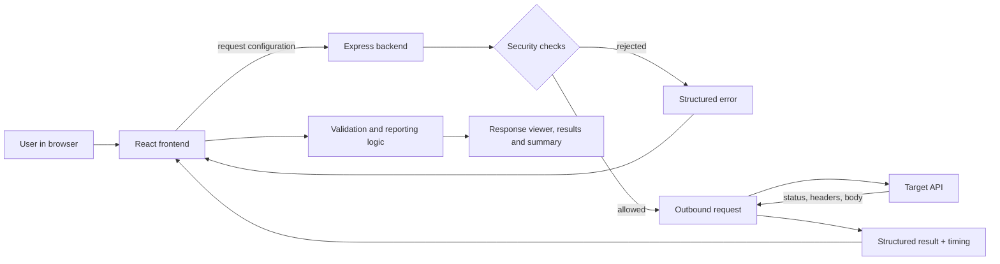

# API Sentinel: Product Requirements Document

## 1. Document Information

| Field | Value |
|---|---|
| Product name | API Sentinel |
| Document title | API Sentinel Product Requirements Document (PRD) |
| Version | 1.0 |
| Status | Draft, ready for implementation planning |
| Project category | Developer Tools / Backend Engineering |
| Product type | Web-based API testing and validation tool |
| Intended audience | Hackathon judges, development team members, AI coding assistants |
| Development time constraint | 5 hours (300 minutes), AI-assisted coding |

**Document conventions.** Requirement IDs use these prefixes: FR (functional), NFR (non-functional), SEC (security), AC (acceptance criteria), SM (success metric). Priorities are P0 (must have), P1 (should have) and P2 (future). Every numeric target in this document is a **proposed target**, not an established fact. Nothing in this document claims the application already exists, has been deployed, or has passed any test.

---

## 2. Executive Summary

API Sentinel is a lightweight web application that lets a user send an HTTP request to any public API, inspect the response, and check that response against simple expectations. The user chooses a method, enters a URL, optionally adds headers and a JSON body, and presses Send. The app shows the status code, response time, headers and body, then evaluates the checks the user configured and produces a clear PASS/FAIL report with a summary.

**Problem.** Developers, students and testers often need to answer a simple question: "Did this API return what I expected?" Answering it by hand means reading raw output and comparing it by eye. Full-featured tools solve it but carry a learning curve and setup cost that is out of proportion for quick checks.

**Solution.** A focused tool with one workflow: configure, send, inspect, validate, summarize. Requests are made by a small backend service, because browsers block direct calls to most third-party APIs. The backend also protects itself from being abused as an open proxy.

**Target users.** Beginner developers, students, backend developers debugging endpoints, and QA testers doing quick response checks.

**Expected value.** Faster feedback on API behavior, fewer manual comparisons, and an easy first step into API testing, delivered as a working end-to-end MVP within five hours.

---

## 3. Problem Statement

### 3.1 Original problem

Developers need a quick way to inspect API responses and identify failures. The product is a web application that lets users send HTTP requests, inspect responses, and run basic validation checks. The core capabilities are: sending requests with different methods, configuring headers and bodies, displaying status codes, response times and bodies, validating expected status codes and basic JSON structure, and generating a summary of passed and failed checks.

### 3.2 Difficulties this product addresses

| Difficulty | Description |
|---|---|
| Sending and configuring requests | Beginners must assemble the method, URL, headers and body correctly, often in a command line or a heavyweight tool. Small mistakes (missing content type, malformed body) produce confusing failures. |
| Inspecting response details | Raw output mixes status, headers and body. Minified JSON is hard to read, and timing is rarely visible without extra tooling. |
| Identifying incorrect status codes | An API can return 200 for a failed operation or 404 where 200 was expected. Without an explicit expectation, a wrong code is easy to overlook. |
| Detecting missing or unexpected JSON fields | A response can be valid JSON yet lack a field a client depends on. Finding that by eye does not scale beyond trivial payloads. |
| Manually tracking results | Without a summary, a tester must remember which expectations held and which failed. |

### 3.3 Core problem versus future opportunities

**Core problem (in scope):** send a request, see the real response, and check status code and required top-level JSON fields with a trustworthy pass/fail summary.

**Future opportunities (not MVP):** saved collections, history, nested JSON path checks, exportable reports, scheduled monitoring, load testing and AI explanations. These are listed in Section 22 and must not displace the core workflow.

---

## 4. Product Vision and Goals

**Vision.** Make "send a request and check the answer" so simple that a beginner can do it in under a minute.

**Primary goal.** Deliver a deployed, working end-to-end flow: real HTTP requests, response inspection, expected-status validation, required JSON field checks, and an accurate test summary.

**Secondary goals.**

1. Be understandable to someone who has never used an API testing tool.
2. Give plain-language explanations for every failure.
3. Be safe enough to host publicly without becoming an open proxy.
4. Stay small enough that one team can build, test and deploy it within five hours.

**User value proposition.** Send a request and learn within seconds whether the response matches what you expect, with the reason shown when it does not.

**Product differentiator.** Focus and clarity. API Sentinel pairs the request and the expectation on the same screen and reports expected versus actual values in plain English. It is intentionally minimal and beginner-friendly.

**Positioning.** API Sentinel is a lightweight, beginner-friendly API testing tool. It is **not** a replacement for advanced platforms such as Postman, and it does not aim to match their collections, scripting, environments or team features.

---

## 5. Target Users and Personas

### Persona 1: Asha, beginner developer

| Attribute | Detail |
|---|---|
| Background | Second-year student building her first app that consumes a public API. |
| Goals | Understand what an API returns and confirm her requests are correct. |
| Pain points | Unsure how to set headers or a JSON body; raw output is hard to read; unclear what a status code implies. |
| Expected workflow | Load an example URL, press Send, read the formatted response, add a status check and a field check, read the summary. |
| How API Sentinel helps | Example loading, formatted JSON, plain-language errors, and a visible pass/fail list teach the concepts while she works. |

### Persona 2: Ravi, backend developer

| Attribute | Detail |
|---|---|
| Background | Developer maintaining REST endpoints for a small product. |
| Goals | Quickly verify that an endpoint returns the right status and the fields clients rely on. |
| Pain points | Switching to a heavyweight tool for a one-off check; no quick view of response time. |
| Expected workflow | Enter endpoint, set method, headers and body, set expected status and required fields, Send, review failures. |
| How API Sentinel helps | One screen for request, response and checks; expected versus actual values make regressions obvious. |

### Persona 3: Meera, student QA tester

| Attribute | Detail |
|---|---|
| Background | Testing a classmate's project API as part of a course. |
| Goals | Produce evidence that endpoints behave as documented, including error cases. |
| Pain points | Tracking results in notes by hand; unsure how to test error responses. |
| Expected workflow | Run several requests, including a deliberate 404, configure the expected status per run, and use the summary as evidence. |
| How API Sentinel helps | Counts, percentages and per-check explanations replace manual note-taking. |

---

## 6. User Stories and Jobs to Be Done

**Jobs to be done.** "When I have an API endpoint, I want to see exactly what it returns and know whether it matches my expectations, so I can trust it or fix it."

| ID | User story | Acceptance criteria |
|---|---|---|
| US-01 | As a user, I want to enter a URL and choose an HTTP method, so that I can target any endpoint. | The URL field accepts text; the method selector offers GET, POST, PUT, PATCH, DELETE; the default method is GET; an empty URL blocks sending with a clear message. |
| US-02 | As a user, I want to add, edit and remove request headers, so that I can send authentication or content-type information. | Headers can be added and removed as name/value rows; rows with an empty name are ignored; invalid header names are rejected with a message. |
| US-03 | As a user, I want to supply a JSON body for methods that accept one, so that I can test create and update endpoints. | The body editor is available for POST, PUT, PATCH and DELETE; invalid JSON is flagged before sending; GET ignores any body. |
| US-04 | As a user, I want to send the request and see a loading state, so that I know something is happening and cannot submit twice. | While a request is in flight, Send is disabled and shows a loading label; it re-enables on completion or failure. |
| US-05 | As a user, I want to see status code, response time, headers and body, so that I can understand what the API returned. | All four are displayed after a successful execution; JSON bodies are pretty-printed; non-JSON bodies are shown as plain text; an empty body shows an explicit empty message. |
| US-06 | As a user, I want to set an expected status code, so that I know if the API returned the right result. | An expected-status input accepts integers 100 to 599; the result shows expected and actual with PASS or FAIL. |
| US-07 | As a user, I want to list required top-level JSON fields, so that I can detect missing data. | Fields can be entered as a list; each field yields its own PASS or FAIL; a missing field is reported by name. |
| US-08 | As a user, I want to expect a JSON body, so that malformed or non-JSON responses are flagged. | When enabled, a JSON-syntax assertion is added; invalid JSON yields FAIL with an explanation. |
| US-09 | As a user, I want a summary of passed and failed checks, so that I can judge the run at a glance. | The summary shows total, passed, failed and pass percentage computed by the rules in Section 12. |
| US-10 | As a user, I want understandable errors when a request cannot be executed, so that I can fix my input. | Invalid URL, blocked destination, network failure and timeout each show a distinct plain-language message and no assertion results. |
| US-11 | As a user, I want the app to work on a phone-width screen, so that I can use it anywhere. | At narrow widths the layout stacks vertically with no horizontal page scrolling. |

---

## 7. Functional Requirements

### A. Request Builder

| ID | Priority | Requirement |
|---|---|---|
| FR-01 | P0 | The app shall provide a URL input accepting absolute `http` or `https` URLs. |
| FR-02 | P0 | The app shall provide a method selector with GET, POST, PUT, PATCH and DELETE, defaulting to GET. |
| FR-03 | P0 | The app shall provide a headers editor of name/value rows with add and remove controls. Rows with an empty name are ignored on send. |
| FR-04 | P0 | The app shall provide a JSON body editor enabled for POST, PUT, PATCH and DELETE. For GET, the body shall be disabled or ignored, and the user shall be told. |
| FR-05 | P0 | Before sending, the app shall validate that the URL is non-empty and that any entered body is syntactically valid JSON, showing an inline message otherwise. |
| FR-06 | P0 | The Send button shall be disabled and show a loading indicator while a request is in flight, preventing duplicate submissions. |
| FR-07 | P1 | The app shall offer a "Load example" action that fills a known public test API request. |
| FR-08 | P1 | Submitting from the URL field with the Enter key shall behave the same as pressing Send. |

### B. HTTP Request Execution

| ID | Priority | Requirement |
|---|---|---|
| FR-09 | P0 | The frontend shall submit the request configuration (URL, method, headers, optional body) to the API Sentinel backend; it shall never call the target API directly from the browser. |
| FR-10 | P0 | The backend shall validate the input, apply the security checks in Section 14, then perform the outbound request with the native Fetch API. |
| FR-11 | P0 | The backend shall return the target's status code, status text, response time, response headers, response body and body size on success. |
| FR-12 | P0 | HTTP error responses from the target (4xx, 5xx) shall be treated as **successful executions** carrying an error status; they are returned in full and are valid inputs to assertions. |
| FR-13 | P0 | Network failures (DNS failure, connection refused, reset) shall be returned as a distinct execution error with a plain-language message. |
| FR-14 | P0 | Requests exceeding the timeout (proposed: 15 seconds) shall be aborted and returned as a distinct timeout error. |
| FR-15 | P0 | Response time shall be measured on the backend from just before the outbound request starts to when the full body has been received. |
| FR-16 | P1 | Responses larger than the size cap (proposed: 1 MB) shall be truncated or rejected with an explicit message rather than exhausting memory. |

### C. Response Viewer

| ID | Priority | Requirement |
|---|---|---|
| FR-17 | P0 | After a successful execution, the viewer shall display status code with status text, response time in milliseconds, response size, headers and body. |
| FR-18 | P0 | If the body parses as JSON, it shall be shown pretty-printed; otherwise it shall be shown unchanged as plain text. |
| FR-19 | P0 | An empty body shall show an explicit "empty response body" message, not a blank area. |
| FR-20 | P0 | Before any request, the viewer shall show an empty state that explains how to begin. |
| FR-21 | P0 | On execution failure, the viewer shall show the error state and shall not display stale data from a previous request as if it were current. |
| FR-22 | P1 | Status shall be colour-coded (2xx success, 3xx informational, 4xx client error, 5xx server error) and also carry a text label, so colour is never the only signal. |

### D. Validation Engine

| ID | Priority | Requirement |
|---|---|---|
| FR-23 | P0 | The user shall be able to configure an expected HTTP status code (integer 100 to 599). If left blank, no status assertion is created. |
| FR-24 | P0 | The user shall be able to enable "response must be valid JSON". When enabled, a JSON-syntax assertion is created. |
| FR-25 | P0 | The user shall be able to list required top-level JSON fields. Each field creates one assertion. |
| FR-26 | P0 | Each assertion shall produce a result with: name, PASS or FAIL, expected value, actual value, and a plain-language explanation when failed. |
| FR-27 | P0 | Assertions shall be evaluated only when the request executed successfully (a response was received). Execution failures produce no assertion results. |
| FR-28 | P0 | Validation shall run in the browser against the returned response, using the pure rules in Section 12, and re-run when the user changes assertions after a response is available. |
| FR-29 | P0 | The UI and documentation shall not imply that a passing status code alone proves the application is correct. |
| FR-30 | P1 | Response-time threshold assertions ("under N ms") may be offered if time allows. |
| FR-31 | P2 | Nested field paths and field-type checks are future enhancements. |

### E. Test Summary

| ID | Priority | Requirement |
|---|---|---|
| FR-32 | P0 | The summary shall show total assertions, passed, failed and pass percentage, calculated as in Section 12.10. |
| FR-33 | P0 | The summary shall list every assertion result with its explanation for failures. |
| FR-34 | P0 | The UI shall clearly distinguish **request execution failure** (no response received, no assertions evaluated) from **assertion failure** (response received, one or more checks failed). |
| FR-35 | P0 | With zero assertions configured, the summary shall say that no checks were configured and shall not display a pass percentage. |
| FR-36 | P1 | An overall banner shall state "All checks passed" or "N checks failed" using text plus colour. |

### F. User Experience

| ID | Priority | Requirement |
|---|---|---|
| FR-37 | P0 | The layout shall be responsive from roughly 360 px width to desktop. |
| FR-38 | P0 | The page shall have a clear visual hierarchy: header, request builder, validation configuration, response, summary. |
| FR-39 | P0 | Empty, loading, success and error states shall exist for the response and summary areas. |
| FR-40 | P0 | Validation and error messages shall use plain, beginner-friendly language. |
| FR-41 | P1 | Interactive controls shall be keyboard reachable, with visible focus and labelled inputs. |

---

## 8. Non-Functional Requirements

| ID | Category | Requirement (targets are proposed) |
|---|---|---|
| NFR-01 | Performance | The app shall add minimal overhead to the target's own latency. Measured response time reflects the backend-to-target round trip, not browser-to-backend time. Proposed target: backend overhead is small relative to target latency, to be observed during testing and not guaranteed. |
| NFR-02 | Performance | Proposed target: the page is interactive within a few seconds on a typical broadband connection, excluding hosting cold starts. |
| NFR-03 | Reliability | The backend shall never crash on malformed input; every failure path shall return a structured error. |
| NFR-04 | Reliability | The backend shall enforce a timeout on every outbound request so no request hangs indefinitely. |
| NFR-05 | Usability | A first-time user shall be able to complete the example workflow without reading documentation. Proposed target: under two minutes. |
| NFR-06 | Maintainability | Code shall be organized so that request execution, validation logic and presentation are separate, and validation rules are independently testable. |
| NFR-07 | Browser compatibility | The app shall work in current versions of Chrome, Edge, Firefox and Safari. |
| NFR-08 | Responsive design | No horizontal page scrolling at 360 px width; wide content (bodies, headers) scrolls inside its own container. |
| NFR-09 | Error handling | No raw stack traces or internal details shall appear in the UI or in API responses. |
| NFR-10 | Security | The essential protections in Section 14 are mandatory (SEC-01 to SEC-12). |
| NFR-11 | Accessibility | Status shall not rely on colour alone; controls shall have labels; text contrast shall be sufficient for legibility. Proposed target: WCAG 2.1 AA contrast for body text. |

---

## 9. Technology Stack and Justification

The stack below is a **recommendation** for a five-hour build. It does not claim that anything is already implemented.

| Technology | Responsibility | Why it suits this project | Interaction with other components | Why not add more complexity |
|---|---|---|---|---|
| React | Frontend UI: request builder, response viewer, validation results, summary | Component model maps naturally to the panels; large ecosystem; familiar to AI coding assistants and most students | Holds request and assertion state; calls the backend endpoint; renders results | Plain component state is enough; a state-management library or router would add setup time with no MVP benefit |
| Vite | Dev server and production bundler for the frontend | Fast start, minimal configuration, simple environment-variable handling | Produces the static build deployed to the frontend host; injects the backend base URL at build time | Heavier frameworks (server rendering, meta-frameworks) are unnecessary for a single-page tool |
| JavaScript | Language for frontend and backend logic | One language across the stack reduces context switching | Validation logic is plain functions usable by the UI | TypeScript would add configuration and type work that is not justified in five hours |
| Node.js | Backend runtime | Native Fetch support and the same language as the frontend | Runs the Express service | Other runtimes would add a second language |
| Express.js | Backend HTTP endpoints: health check and request-execution endpoint | Minimal, well documented, quick to secure with middleware (CORS, rate limit, JSON parsing) | Receives the contract in Section 11; performs outbound requests; returns structured results | A larger framework or API gateway is excessive for two endpoints |
| Native Fetch API | Outbound requests from backend to target APIs | Built into modern Node; supports timeouts through abort signals; no dependency | Used only by the execution layer after security checks | An HTTP client library adds a dependency with no required feature |
| Plain CSS or Tailwind CSS | Styling | Plain CSS has zero setup; Tailwind speeds up layout if the team already knows it. Choose one, not both | Applied to React components | A component library would add learning and bundle cost |
| GitHub | Version control and collaboration | Required for submission; supports small frequent commits | Triggers redeploys on both hosts | No additional CI is needed for the MVP |
| Vercel | Frontend hosting | Free tier, deploys a static build from GitHub with minimal configuration | Serves the frontend; its origin must be allowed by the backend CORS policy | A custom CDN or container setup is unnecessary |
| Render | Backend hosting | Free web service tier, deploys a Node service from GitHub, supports environment variables | Hosts the Express service; its public URL is configured in the frontend build | Containers or serverless functions add configuration without MVP value |

**Explicit exclusions for the MVP.** A database, an authentication system and AI API integration are **not required** for the initial MVP and shall not be added unless a demonstrated requirement justifies them. Request history, if offered, is browser-local and optional.

---

## 10. System Architecture and Component Responsibilities

### 10.1 Components

| Component | Responsibility |
|---|---|
| Frontend presentation layer | Collects request configuration and assertions; shows loading, errors, response and results; runs the validation rules against the received response; computes the summary. |
| Backend request-execution layer | Validates input; applies security checks; performs the outbound request; measures time; enforces timeout and size limits; returns a structured result or structured error. |
| External (target) API | Any public HTTP API the user wishes to test. Untrusted and outside the team's control. |
| Validation and reporting logic | Pure functions that take assertions plus the response and return per-assertion results and summary counts. It has no network or UI dependencies. |
| Frontend-backend communication | A single JSON request/response contract (Section 11) over HTTPS. |
| Configuration | Frontend: backend base URL. Backend: allowed frontend origin(s), port, timeout and size-limit values. |

### 10.2 Request-response lifecycle

1. The user enters the URL, method, headers, optional body and assertions.
2. The frontend validates the basics (URL not empty, body is valid JSON) and disables Send.
3. The frontend sends the request configuration to the backend endpoint.
4. The backend validates the payload shape and applies URL, protocol, method and header checks.
5. The backend resolves the hostname and rejects blocked destinations.
6. The backend performs the outbound request with a timeout, handling redirects as specified in Section 14.
7. The backend reads the body within the size cap and records elapsed time.
8. The backend returns a structured success result, or a structured error with a code and safe message.
9. The frontend displays the response (or the execution error) and re-enables Send.
10. If a response was received, the frontend runs the assertions and renders per-assertion results and the summary.

### 10.3 Data-flow diagram



---

## 11. API Contract Requirements

This is the conceptual contract between the frontend and the backend. Field names are proposals and shall be used consistently by both sides.

### 11.1 Endpoints

| Endpoint | Method | Purpose |
|---|---|---|
| `/api/send` | POST | Execute a request against a target URL and return the result. |
| `/health` | GET | Report that the backend is running (used for deployment checks). |

### 11.2 Request fields (frontend to backend)

| Field | Type | Required | Description |
|---|---|---|---|
| `url` | string | Yes | Absolute http or https target URL. |
| `method` | string | Yes | One of GET, POST, PUT, PATCH, DELETE. |
| `headers` | object of string to string | No | Headers to forward. Subject to header validation. |
| `body` | string | No | Raw JSON text. Ignored for GET. |

Illustrative request:

```json
{
  "url": "https://example.com/api/items/1",
  "method": "GET",
  "headers": { "Accept": "application/json" },
  "body": ""
}
```

### 11.3 Success response (backend to frontend)

| Field | Type | Description |
|---|---|---|
| `status` | integer | The **target API's** HTTP status code. |
| `statusText` | string | The target's status text. |
| `timeMs` | integer | Elapsed time for the outbound request, in milliseconds. |
| `headers` | object | The target's response headers. |
| `body` | string | The target's response body as text, subject to the size cap. |
| `sizeBytes` | integer | Size of the body received. |
| `truncated` | boolean | Whether the body was cut at the size cap (P1). |

Illustrative success response:

```json
{
  "status": 200,
  "statusText": "OK",
  "timeMs": 142,
  "headers": { "content-type": "application/json" },
  "body": "{\"id\":1,\"name\":\"Example\"}",
  "sizeBytes": 26,
  "truncated": false
}
```

### 11.4 Error response (request execution errors)

When API Sentinel cannot execute the request, it returns an error object instead of a target response.

| Field | Type | Description |
|---|---|---|
| `error.code` | string | A stable code such as `INVALID_INPUT`, `BLOCKED_DESTINATION`, `NETWORK_ERROR`, `TIMEOUT`, `RESPONSE_TOO_LARGE`, `RATE_LIMITED`. |
| `error.message` | string | A plain-language, secret-free explanation. |
| `timeMs` | integer | Optional elapsed time before failure. |

Illustrative error response:

```json
{
  "error": {
    "code": "TIMEOUT",
    "message": "The target did not respond within 15 seconds."
  },
  "timeMs": 15001
}
```

### 11.5 Status-code separation

The **target API's status** is carried in the `status` field of the response body. It is **separate** from the HTTP status of API Sentinel's own backend response. The backend shall use these transport statuses:

| Situation | Backend HTTP status | Body |
|---|---|---|
| Target responded (any status, including 4xx and 5xx) | 200 | Success response containing the target's `status` |
| Invalid input or blocked destination | 400 | Error object |
| Rate limit exceeded | 429 | Error object |
| Target unreachable or network failure | 502 | Error object |
| Target timed out | 504 | Error object |

The frontend shall decide success or failure by the presence of an `error` object, never by assuming the backend status equals the target status.

---

## 12. Validation Rules and Business Logic

These rules are authoritative. Different implementations shall produce the same results.

### 12.1 Assertion creation

| Assertion | Created when |
|---|---|
| Status code | The user has entered an expected status. |
| JSON syntax | The user has enabled "response must be valid JSON". |
| Required field | One assertion for each non-empty, trimmed, de-duplicated entry in the required fields list. |

### 12.2 Status-code equality

PASS if the target's status equals the expected integer exactly; otherwise FAIL. Expected value must be an integer from 100 to 599. Actual is shown as the numeric code. A 404 or 500 is a valid response: if the user expects 404 and receives 404, the assertion passes.

### 12.3 JSON validity

The body is "valid JSON" if it parses successfully as JSON. An empty body is **not** valid JSON. The JSON-syntax assertion PASSes if the body is valid JSON and FAILs otherwise, with the explanation "The response body is not valid JSON."

### 12.4 Required JSON field checks

- Evaluation applies only to **top-level properties** of a JSON **object**.
- A field PASSes if the property exists on the top-level object, regardless of its value. A property whose value is `null` or an empty string **exists**.
- Matching is exact and case-sensitive.
- A field FAILs with "Field `name` is missing from the response" if absent.

### 12.5 Missing fields, malformed JSON and non-JSON

| Situation | Required-field assertion result | JSON-syntax assertion (if configured) |
|---|---|---|
| Body is valid JSON object, field present | PASS | PASS |
| Body is valid JSON object, field absent | FAIL: field missing | PASS |
| Body is valid JSON but an array or primitive | FAIL: "The top-level JSON value is not an object, so field names cannot be checked." | PASS |
| Body is malformed JSON | FAIL: "The response body is not valid JSON, so fields could not be checked." | FAIL |
| Body is plain text (such as HTML) | FAIL: same message as malformed JSON | FAIL |
| Body is empty | FAIL: same message as malformed JSON | FAIL |

Field assertions shall be counted in the totals and shown as failures in these cases; they shall not be silently skipped.

### 12.6 HTTP errors

A 4xx or 5xx response is a received response. Assertions are evaluated normally. The UI shall show the error status clearly but shall not classify the run as an execution failure.

### 12.7 Network failures

If no HTTP response is received (DNS failure, refused connection, reset), the run is an **execution failure**. No assertions are evaluated. The summary area shall show "Request could not be completed" with the error message, not zero passes.

### 12.8 Timeouts

A timeout is an execution failure with the code `TIMEOUT`. No assertions are evaluated. The message states the time limit.

### 12.9 Zero configured assertions

If a response was received but no assertions exist, the summary shall show total 0, passed 0, failed 0, pass percentage "not applicable", and the message "No checks configured. Add a check to validate this response." The response itself is still displayed.

### 12.10 Summary calculations

- **Total** = number of assertions evaluated.
- **Passed** = number of assertions with PASS.
- **Failed** = Total minus Passed.
- **Pass percentage** = Passed divided by Total times 100, rounded to the nearest whole number; displayed only when Total is greater than 0.
- Overall state: "All checks passed" when Failed is 0 and Total is greater than 0; "Some checks failed" when Failed is greater than 0.

Worked example: three assertions with two passes gives Total 3, Passed 2, Failed 1, Pass percentage 67 percent.

---

## 13. UI/UX Requirements

The UI is a single page. All areas shall be feasible within the five-hour limit.

| Area | Purpose | Expected behavior |
|---|---|---|
| Application header | Identify the product and its purpose | Shows the name "API Sentinel" and a one-line description. |
| Request builder | Gather the full request configuration | Groups method, URL, headers, body and Send in one card. |
| Method selector | Choose the HTTP method | Dropdown with five methods; default GET; changing it updates body availability. |
| URL field | Enter the target | Placeholder shows an example; inline error for empty or invalid values. |
| Headers editor | Add custom headers | Name/value rows, add and remove controls; one starter row may be pre-filled. |
| Request body editor | Enter JSON for applicable methods | Multi-line text area; disabled with explanation for GET; invalid JSON flagged before send. |
| Validation configuration | Define assertions | Expected status input, "response must be valid JSON" toggle, required fields list; helper text explains each. |
| Send button | Trigger execution | Disabled with loading label while in flight; re-enabled after completion. |
| Response overview | Show the headline result | Status code with text and label, response time, size. |
| Response body viewer | Show body and headers | Pretty-printed JSON or plain text in a scrollable container; headers in a separate scrollable block. |
| Assertion results | Show each check | One row per assertion with PASS/FAIL text label, expected, actual, and explanation for failures. |
| Summary panel | Show the run outcome | Total, passed, failed, percentage, overall banner; distinct styling for execution failure versus assertion failure. |

**States.**

| State | Behavior |
|---|---|
| Empty | Response area explains how to send the first request. |
| Loading | Send disabled; loading indicator in the response area. |
| Success | Response and results displayed. |
| Execution error | Error message displayed in the response and summary areas; no assertion results. |
| Zero assertions | Response displayed; summary shows the no-checks message. |

**Accessibility and visual rules.** Status and PASS/FAIL are communicated with text as well as colour. Inputs have visible labels. Interactive controls show focus. The layout stacks on narrow screens.

---

## 14. Security and Abuse Prevention

Because the backend makes outbound requests to user-supplied URLs, an unprotected implementation would be an open proxy and an SSRF risk. The browser's own security shall never be disabled, and the backend shall never act as an unrestricted public proxy.

### 14.1 Essential protections (required for the MVP)

| ID | Requirement |
|---|---|
| SEC-01 | **URL and protocol validation.** The URL shall parse as an absolute URL; only `http` and `https` are allowed; URLs with embedded credentials are rejected. |
| SEC-02 | **Blocked destinations.** Reject localhost, loopback, unspecified addresses, private ranges, link-local ranges and cloud metadata endpoints. This includes the IPv4 private ranges, the carrier-grade NAT range, IPv4 link-local (which contains the cloud metadata address), and the IPv6 loopback, unique-local and link-local ranges, including IPv4-mapped IPv6 forms. |
| SEC-03 | **DNS resolution check.** Resolve the hostname before connecting and reject the request if **any** resolved address is blocked. The connection shall use the validated address, to reduce DNS-rebinding risk. |
| SEC-04 | **Redirect handling.** Do not follow redirects blindly. Either do not follow them (return the redirect response as-is) or follow a small limit (proposed: 3) with the full SEC-01 to SEC-03 checks repeated on every hop. |
| SEC-05 | **Timeout.** Every outbound request shall abort after a fixed time (proposed: 15 seconds). |
| SEC-06 | **Response-size limit.** Reading the body shall stop at a fixed cap (proposed: 1 MB) to protect memory. |
| SEC-07 | **Method restriction.** Only GET, POST, PUT, PATCH and DELETE are accepted. |
| SEC-08 | **Header validation.** Header names and values shall be well-formed; headers that control connection routing or could confuse the proxy (for example Host, Connection, Content-Length, Transfer-Encoding) shall be stripped or rejected. |
| SEC-09 | **CORS configuration.** The backend shall allow only the deployed frontend origin (and a local development origin) rather than all origins. |
| SEC-10 | **Credential protection.** The backend shall not log, store or echo user-supplied authorization headers or bodies. No secrets shall be committed to the repository; configuration shall come from environment variables. |
| SEC-11 | **Safe error messages.** Errors shall be generic and secret-free: no stack traces, internal addresses, file paths or environment values. |
| SEC-12 | **Request-body limit.** The backend shall limit the size of incoming request configuration (proposed: 1 MB). |

### 14.2 Additional hardening (if time permits)

| ID | Requirement |
|---|---|
| SEC-13 | **Rate limiting** per client address on the execution endpoint (proposed: a modest number of requests per minute). |
| SEC-14 | Restrict outbound ports to common web ports (80, 443) or an allowlist. |
| SEC-15 | Strip or limit sensitive response headers such as cookies from being displayed. |
| SEC-16 | Add basic security headers to backend responses. |
| SEC-17 | Log blocked-request counts without logging request content. |

### 14.3 Disclosure

The README and UI shall state that destination blocking is basic protection suitable for a hackathon demo, not a certified security boundary.

---

## 15. MVP Scope and Prioritization

### P0: Must Have

| Item | Related requirements |
|---|---|
| URL input, method selector (five methods), headers editor, JSON body editor, Send with loading and duplicate-submit prevention | FR-01 to FR-06 |
| Real outbound requests via the backend, structured success and error results, timeout | FR-09 to FR-15 |
| Response viewer: status, time, headers, body, JSON formatting, plain-text fallback, empty and error states | FR-17 to FR-21 |
| Expected-status validation | FR-23, FR-26 to FR-28 |
| Required top-level JSON field checks and JSON-syntax check | FR-24, FR-25 |
| Accurate summary: total, passed, failed, percentage, zero-assertion behavior, execution-versus-assertion distinction | FR-32 to FR-35 |
| Responsive layout and plain-language messages | FR-37 to FR-40 |
| Essential security protections | SEC-01 to SEC-12 |
| Deployment of frontend and backend, verified end to end | Section 19 |

### P1: Should Have

| Item | Related requirements |
|---|---|
| Load-example action, Enter-to-send | FR-07, FR-08 |
| Response size cap messaging | FR-16 |
| Colour-coded status with text labels | FR-22 |
| Overall pass/fail banner | FR-36 |
| Keyboard focus polish | FR-41 |
| Response-time assertions | FR-30 |
| JSON syntax highlighting, local request history, downloadable report, nested JSON validation (each optional) | None required |
| Rate limiting and other additional hardening | SEC-13 to SEC-17 |

### P2: Future Enhancements (excluded from the five-hour build)

Saved collections, persistent history, historical comparisons, nested path and type validation, exportable reports, AI-assisted explanations, authentication and team features, scheduled runs. See Section 22.

**Rule:** no P1 or P2 item may begin until the P0 end-to-end flow works locally and is deployed.

---

## 16. Acceptance Criteria

| ID | Scenario | Setup / input | Expected behavior | Pass criteria |
|---|---|---|---|---|
| AC-01 | Successful GET request | GET to a known public JSON endpoint | Response displayed with status, time, headers, formatted body | Status shows a 2xx code; time is a number; body is pretty-printed |
| AC-02 | POST with JSON body | POST to a public test endpoint that accepts JSON; valid JSON body | Request reaches target; creation-style status returned | Status matches the target's documented success code; body reflects the sent data |
| AC-03 | Custom headers | Add a header, send to an endpoint that echoes request headers | Target receives the header | Echoed headers include the custom header |
| AC-04 | Expected status passes | Expected status equals the actual status | Assertion shows PASS with expected and actual | PASS row; counts reflect it |
| AC-05 | Expected status fails | Expected status differs from actual | Assertion shows FAIL with explanation | FAIL row naming both values; failed count increments |
| AC-06 | All required fields exist | Required fields all present at top level | One PASS per field | All field rows PASS |
| AC-07 | Required field missing | Add a field name absent from the response | That field shows FAIL "missing" | FAIL row names the field; other fields unaffected |
| AC-08 | Invalid JSON in response | Target returns malformed JSON with JSON validation and field checks enabled | JSON-syntax and field assertions FAIL with explanations | All related rows FAIL; counted in totals; body shown as text |
| AC-09 | Plain-text response | Target returns plain text or HTML | Body shown unchanged as text; JSON assertions FAIL | No formatting errors; FAIL explanations match Section 12.5 |
| AC-10 | HTTP error from target | Request a path that returns 404 (or 500) | Response displayed with error status; assertions evaluated normally | Not shown as an execution failure; expecting 404 passes |
| AC-11 | Network failure | URL with a hostname that does not resolve | Execution error with plain message; no assertions | Error state shown; no PASS/FAIL rows; Send re-enabled |
| AC-12 | Timeout | Target that responds slower than the timeout | Execution error stating the time limit | `TIMEOUT` error; no assertions; UI recovers |
| AC-13 | No assertions configured | Successful request, no checks | Response shown; summary says no checks configured | Total 0; percentage not displayed; message present |
| AC-14 | Summary counts correct | Configure a mix, for example 3 checks with 2 passing | Counts and percentage match rules | Total 3, Passed 2, Failed 1, 67 percent; matches row-by-row count |
| AC-15 | Frontend to deployed backend | Deployed frontend, deployed backend, example request | Full round trip succeeds without CORS errors | Response displayed on the public site; browser console shows no CORS errors |
| AC-16 | Unsafe URLs rejected | Try localhost, a private-range address, a metadata address, a non-http scheme, and a hostname resolving to a private address | Each rejected before any outbound request | Clear "not allowed" error each time; no response data shown |
| AC-17 | Duplicate submission prevented | Click Send repeatedly while in flight | Only one request is made | Send disabled during flight; one result displayed |
| AC-18 | Invalid input handling | Empty URL, malformed URL, invalid JSON body | Inline messages; no request made | Each case shows its own message |
| AC-19 | Responsive layout | Open at about 360 px width | Layout stacks; controls usable | No horizontal page scrolling |
| AC-20 | Oversized response | Target returns a body above the cap | Handled per SEC-06 with a clear message | No crash; message visible |

Results shall be recorded honestly at test time. This table defines how to test; it contains no recorded results.

---

## 17. Success Metrics

| ID | Metric | Proposed target | How measured |
|---|---|---|---|
| SM-01 | Core acceptance tests passed (AC-01 to AC-16) | 100 percent of P0 scenarios | Manual run of the Section 16 checklist; record actual pass/fail |
| SM-02 | Successful end-to-end request execution | Example request works on the deployed app | Test on the public URL from a clean browser session |
| SM-03 | Validation accuracy | Every assertion result matches the Section 12 rules across the acceptance scenarios | Compare expected and displayed results per scenario |
| SM-04 | Deployment and public access | Frontend and backend reachable without login | Open both from a private browser window |
| SM-05 | Demo workflow usability | A new viewer completes the example workflow unaided | Observe one person following the demo |
| SM-06 | MVP completed within time | All P0 items done within 300 minutes | Compare commit timeline to the plan |
| SM-07 | Security checks effective | All unsafe URL cases in AC-16 rejected | Manual test |

Targets are goals. Measured outcomes shall be recorded separately after testing and shall not be pre-filled.

---

## 18. Five-Hour Delivery Priorities

| Phase | Minutes | Focus |
|---|---|---|
| 1. Project setup | 30 | Repository, project structure for frontend and backend, agreement on the contract in Section 11, health-check endpoint, first deployment of both parts as a "hello world" |
| 2. Backend request execution | 60 | Execution endpoint, structured success and error results, timeout, essential security protections (SEC-01 to SEC-12) |
| 3. Frontend request builder and response viewer | 75 | Request form, headers editor, body editor, loading state, connection to backend, response display and error states |
| 4. Validation engine and summary | 60 | Assertion configuration, Section 12 rules, per-assertion results, summary counts, zero-assertion and execution-failure behavior |
| 5. Hardening and polish | 20 | Responsive layout, message clarity, accessibility basics, P1 items that are quick wins |
| 6. Testing, deployment and final verification | 45 | Run Section 16 checklist locally and deployed, fix defects, confirm CORS alignment, final commit |
| 7. Contingency buffer | 10 | Absorb overruns |
| **Total** | **300** | |

**Contingency guidance if behind schedule.**

1. Protect the P0 path above everything else: request, response, status check, field check, summary.
2. If at the end of Phase 3 the frontend and backend are not connected, pair on the connection before starting any validation work.
3. Drop P1 items first (example loader, banner, extras), then simplify the headers editor to the content-type header only.
4. If the validation phase overruns, ship status and required-field checks only and defer the JSON-syntax toggle.
5. Never skip the essential security protections or the deployed end-to-end test.
6. Keep deployment from becoming a last-minute task by deploying early and redeploying continuously.

---

## 19. Deployment and Environment Requirements

| Topic | Requirement |
|---|---|
| Separate deployments | The frontend (static build) and backend (Node service) are deployed independently, recommended on Vercel and Render respectively. |
| Backend configuration | Environment configuration for: the allowed frontend origin(s), the listening port provided by the host, and (optionally) the timeout and size-limit values. No secrets are required for the MVP. |
| Frontend configuration | A build-time setting for the backend base URL, pointing to the deployed backend. A different value is used for local development. |
| CORS alignment | The backend's allowed origin must exactly match the deployed frontend origin, including scheme and without trailing slash differences. It shall be updated when the frontend URL changes. |
| Production build | The frontend shall build without errors and serve as static files; the backend shall start from its declared start command. |
| Health check | The backend shall expose `/health` returning a simple success indication, usable by the host and by manual checks. |
| Cold starts | Free-tier backends may sleep when idle; the first request after idle can be slow. The UI shall show the loading state, and the team shall wake the backend before demos. |
| End-to-end verification | After each deployment, send the example request from the public frontend and confirm the response, the validation results and the absence of CORS errors in the browser console. |

No deployed URLs, credentials or environment values are specified in this document, and none shall be assumed to exist until the team creates them.

---

## 20. Risks, Assumptions, and Dependencies

### 20.1 Risks

| Risk | Impact | Mitigation |
|---|---|---|
| Browser CORS limitations prevent direct calls to target APIs | Core feature fails | All outbound calls go through the backend; the backend CORS policy allows only the frontend origin |
| External API unavailable or slow | Demo failure | Use stable public test APIs; have a second test API ready; show error states as a feature |
| Hosting cold starts and deployment delays | Slow first request, missed demo | Deploy early; wake the backend before demos; clear loading messaging |
| Unsafe outbound requests (SSRF, open proxy) | Security and abuse risk | Implement SEC-01 to SEC-12; add rate limiting if time permits; document limitations |
| Unexpected response formats (non-JSON, huge, empty) | Crashes or confusing output | Plain-text fallback, size cap, explicit empty state, Section 12.5 rules |
| Five-hour constraint | Incomplete MVP | Strict P0/P1/P2 prioritization; contingency rules in Section 18 |
| Dependency on public test APIs | Tests fail through no fault of the app | Prefer multiple endpoints; treat failures from them as external when diagnosing |
| Misinterpretation of status-only success | Users assume correctness | UI wording and documentation state that a passing status does not prove correctness (FR-29) |

### 20.2 Assumptions

- Users test public, internet-reachable APIs; private network targets are intentionally unsupported.
- Users are comfortable with basic web terminology or will learn from in-app helper text.
- Free hosting tiers are sufficient for the demo.
- The team has accounts with the chosen hosting providers.

### 20.3 Dependencies

- Availability of Node.js, the chosen frontend tooling, GitHub and the two hosting platforms.
- Availability of at least one public test API for demonstration and testing.

---

## 21. Out of Scope

The following are **not MVP commitments**:

- Full API lifecycle management (design, mocking, documentation workflows).
- Complex automated test scripting or programmable assertions.
- Enterprise user management, teams, roles and sharing.
- Persistent database-backed history.
- Advanced load, stress or performance testing.
- Complete security vulnerability scanning of target APIs.
- Guaranteed API uptime monitoring or scheduled checks.
- Production-grade API documentation generation.
- Support for protocols beyond HTTP and HTTPS request/response (for example WebSockets, gRPC).
- Testing of private or internal network APIs.

---

## 22. Future Roadmap

Listed in priority order. None is a mandatory MVP requirement.

| Priority | Enhancement |
|---|---|
| 1 | Nested JSON path validation and field type checks |
| 2 | Response-time threshold checks |
| 3 | Exportable test reports |
| 4 | Saved requests and test collections |
| 5 | Local, then persistent, request history |
| 6 | Historical test comparisons |
| 7 | Optional AI-assisted failure explanations (requires a demonstrated need, an API key strategy and privacy review) |

---

## 23. Final MVP Definition of Done

The product is ready only when every item below is true and has been verified:

- [ ] The frontend and backend communicate successfully.
- [ ] Real HTTP requests can be sent to public APIs.
- [ ] Request methods, headers and bodies work as specified.
- [ ] Actual response details (status, time, headers, body) are displayed.
- [ ] Expected status codes are validated correctly.
- [ ] Required JSON fields are checked correctly.
- [ ] Pass/fail counts and the pass percentage are accurate, including the zero-assertion case.
- [ ] Network, timeout and validation errors are understandable and distinct from assertion failures.
- [ ] Essential outbound-request protections (SEC-01 to SEC-12) are implemented and tested against AC-16.
- [ ] The deployed application has been tested end to end from the public frontend, with no CORS errors.
- [ ] The P0 acceptance checklist has been run and its actual results recorded.
